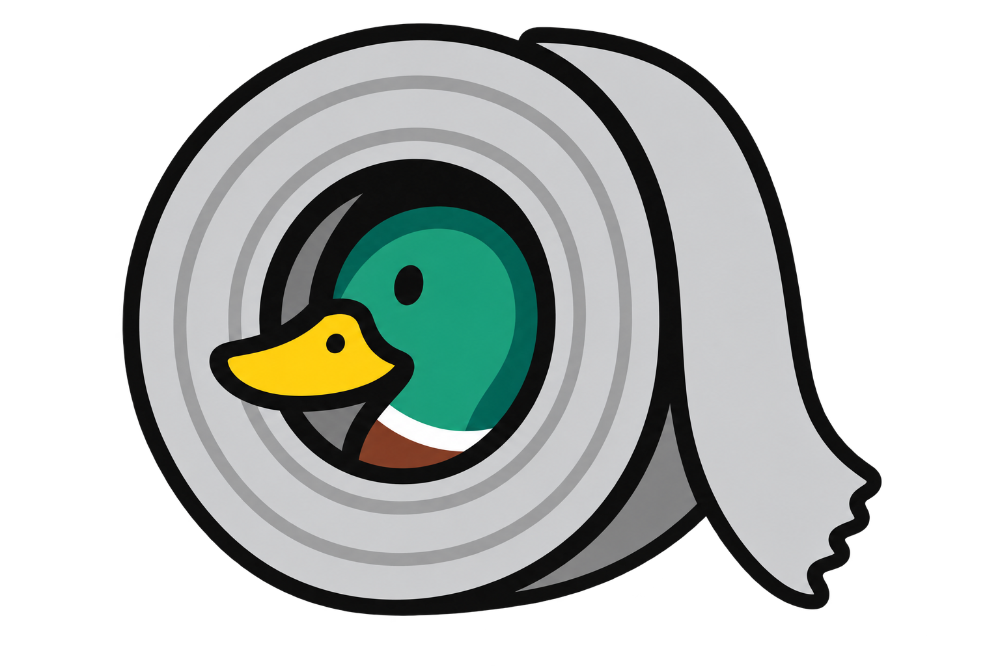

# Ducktape Laya



Embed local Laya classification in C/C++, Rust, Node.js and Electron applications.
One C++ implementation uses a pinned llama.cpp runtime; thin bindings share the
same model loading, inference and result formatting. No HTTP server, Ollama,
Python runtime, child inference process or automatic downloads.

**Status: working Linux CPU prototype.** Real `choice`, `noul` (probability of
true) and ordinal `score` inference is implemented for the pinned English Q8_0
model. It does not generate chat. Professional Linux packaging, reliability
validation and the required WebGPU/WASM browser path remain release work.
Other operating systems are deferred until we can test them. See the
[reviewed plan](docs/PLAN.md) and [validation report](docs/VALIDATION.md).

The shared backend now also implements bounded batching, flat structured
decisions, passive per-call hooks, and explicit local model routing with a
bounded cache. These features are exposed in every language interface, including
TypeScript. Inference uses llama.cpp with GGUF models. See the [shared API](docs/API.md)
for contracts, the [product and release plan](docs/PLAN.md) for priorities, and
[historical comparisons](docs/EVALUATION.md) for research evidence.

The product uses a shared implementation with thin native interfaces. Browser
execution must reuse that core wherever feasible. Demos are optional test tools
and do not drive product design, dependencies or release priorities.

## Alternatives

Different deployment needs may be better served by:

- [Official Laya / laya-ts](https://github.com/NandhaKishorM/laya/tree/main/laya-ts):
  richer TypeScript workflows and an ONNX browser path.
- [LibLayaX](https://github.com/DaragonTech/LibLayaX) and
  [RLaya](https://github.com/DaragonTech/RLaya): native C and Rust embedding.
- [laya.cpp](https://github.com/lkarlslund/laya.cpp): a dedicated native C++ Laya runtime.
- [Candle-based laya-rust](https://github.com/aovestdipaperino/laya-rust) and
  [GGUF laya-rust](https://github.com/zerodegress/laya-rust): Rust inference implementations.
- [receptron/laya](https://github.com/receptron/laya): another Node/ONNX integration.

Our focus is compact GGUF deployment and one implementation shared across language
interfaces. The comparison documents which alternatives we ran and which we only
reviewed; feature lists and star counts alone do not establish maturity.

## Build the library

Requires CMake 3.22+, a C/C++17 compiler and Git. The default Linux x86-64 CPU
build requires AVX2, FMA, F16C, BMI2 and SSE4.2; it is not yet a universal binary
for older CPUs. Only Linux x86-64 has been tested. Initialize the pinned source:

```sh
git submodule update --init --recursive
cmake -S . -B build -DCMAKE_BUILD_TYPE=Release
cmake --build build -j 3
```

Supply a local model, using `models/manifest.json` for the exact tested artifact.
For this machine, the existing cached file works:

```sh
export LAYA_MODEL="$HOME/.cache/huggingface/hub/models--ggml-org--Laya-GGUF/snapshots/22265007700297ba9e128297e82540cf28c5d7d4/Laya-Q8_0.gguf"
python3 scripts/verify-model.py "$LAYA_MODEL"
```

Examples and interactive forms are excluded by default. Enable them explicitly
with `-DDUCKTAPE_BUILD_EXAMPLES=ON`; the `./demo` launcher does this automatically.
For a library-only build, also set `-DDUCKTAPE_BUILD_TESTS=OFF`. Automated tests
use their own public-API consumers and do not build or import demonstrations.

Python 3.11+ is only used for optional developer verification, never by the library.
The model is about 449 MB on disk and is intentionally not in Git. An app can
ship it as an ordinary resource in the same installer as the native library.

## C and C++

The public ABI is [ducktape_laya.h](include/ducktape_laya.h): `dtl_open`,
`dtl_decide`, `dtl_execute`, `dtl_close`, `dtl_free`, plus registry functions. See [the plain-C example](examples/decide.c).
All errors cross the ABI as integer statuses with optional owned messages.
Release every returned string with `dtl_free`, including error messages.

```cpp
#include <ducktape_laya.hpp>
ducktape::laya engine("resources/Laya-Q8_0.gguf");
std::string result = engine.execute(request_json); // primitive, schema, or batch
```

The RAII wrapper releases the engine automatically. Link `ducktape_laya` and
ship its shared library with your app. `cmake --install build --prefix staging`
stages headers, the library, CMake targets and pkg-config metadata.
See [packaging](docs/PACKAGING.md) for installed consumer usage. Model weights
are not installed by CMake.

## Rust

Use the path crate in `bindings/rust/ducktape-laya`. It links the same native
library, with a raw sys crate underneath. It does not rebuild/download llama.cpp.

```rust
let engine = ducktape_laya::Engine::open("resources/Laya-Q8_0.gguf", 2)?;
let result_json = engine.execute(&request_json)?;
```

```sh
export DUCKTAPE_LAYA_LIB_DIR="$PWD/build"
export LD_LIBRARY_PATH="$PWD/build${LD_LIBRARY_PATH:+:$LD_LIBRARY_PATH}"
cargo run --manifest-path bindings/rust/Cargo.toml -p ducktape-laya \
  --example decide -- "$LAYA_MODEL" < examples/request.json
```

`Engine` is `Send + Sync`; native calls on one handle serialize. Calls block the
calling thread. Use a blocking worker pool from async Rust. Dropping the last
owner unloads the model.

## Node.js / Electron

Requires Node.js 20+ and matching platform development headers to build the addon:

```sh
cmake -S . -B build -DDUCKTAPE_BUILD_NODE=ON \
  -DNODE_INCLUDE_DIR=/path/to/include/node
cmake --build build -j 3
node bindings/node/decide.cjs "$LAYA_MODEL" < examples/request.json
```

```js
const { Laya } = require('./bindings/node/index.cjs');
const engine = await Laya.open(modelPath, { threads: 2, maxPending: 16 });
try {
  const result = await engine.decide({
    state: 'Please refund the duplicate charge.',
    questions: {
      refund: { type: 'noul', instructions: 'Does the customer request a refund?' }
    }
  });
  console.log(result.answers.refund.noul);
} finally {
  await engine.close();
}
```

For structured values or multiple inputs, use the same worker:

```js
const structured = await engine.decideStructured({
  state: 'Please refund the duplicate charge.',
  schema: { type: 'object', properties: {
    refund: { type: 'boolean', description: 'Does the customer request a refund?' }
  }}
}, { onEvent: event => console.log(event.event) });
console.log(structured.values.refund);
const results = await engine.decideBatch([requestA, requestB]);
```

Use `Laya.openRouter({ models: { english: modelPath }, max_loaded: 1 })` and
`model: 'english'` on each request for explicit local model selection. It returns
the same API and requires the same `close()`. See [routing and hooks](docs/API.md).

The public API is asynchronous. A dedicated worker thread owns the native handle;
there is no child process. Accepted requests run FIFO, excess work is rejected,
and `close()` drains accepted work. Always close the engine so the worker can
exit. Pass `addonPath` or set `DUCKTAPE_LAYA_ADDON` when moving the addon.

In Electron, create this engine in the main process and expose a narrow,
validated IPC method to renderers with context isolation enabled. Package the
GGUF, `.node`, and shared library as unpacked resources, then resolve paths under
`process.resourcesPath`. A signed, clean-machine-tested installer is a later
milestone; no ready-made Electron package is claimed here.

## Request contract

The shape matches the text-only `/v1/systemone` request in
[examples/request.json](examples/request.json). Results contain `answers` and
`usage`. Structured requests additionally return `values`; registry results
include their explicit `model` ID. Raw filesystem paths never appear in results.
`score` is the expected zero-based criterion index, not a probability.

- Non-null `state` and `instructions` can be text or structured JSON.
- `choice`: 2–255 named options, subject to the token budget.
- `score`: 2–10 ordered levels. `noul`: optional `false`/`true` descriptions.
- At most 32 questions, 1 MiB of UTF-8 JSON, and 512 prompt tokens per question.
- JSON nesting is limited to 64 levels.
- Model-specific instruction/option budgets are also enforced. Where the server
  truncates, this library returns an error so the application can shorten input.
- Questions run separately, one forward pass each. Batches accept 1–32 requests
  and up to 128 total questions within 1 MiB. This does not promise a throughput
  improvement. No model text is generated.
- JSON insertion order affects answers. The core preserves it. JavaScript
  reorders integer-like object keys; pass a raw JSON string to preserve their
  literal order. Avoid duplicate keys in requests.
- One handle serializes calls; independent engines use separate model/context
  memory. Native callers must never race destruction against calls. Backend
  registration lasts for the process lifetime; model/context resources unload.

The model file contains a Jinja template and must be a trusted app resource.
Use the pinned checksum during packaging. Reported probabilities/confidence
are model estimates; evaluate them on your application's own data.

## Tests

```sh
cmake -S . -B build -DDUCKTAPE_BUILD_TESTS=ON -DDUCKTAPE_TEST_MODEL="$LAYA_MODEL"
cmake --build build -j 3
ctest --test-dir build --output-on-failure
LAYA_MODEL="$LAYA_MODEL" cargo test --manifest-path bindings/rust/Cargo.toml
LAYA_MODEL="$LAYA_MODEL" node --test bindings/node/test.cjs
```

Without a model path, CTest runs ABI/error tests only and Node skips its real-model
tests. Rust real-model checks also require `LAYA_MODEL`, plus the native library
loader path shown above. Node tests and cross-language parity require the addon
build described above. Run cross-language primitive/structured batch parity with
`python3 tests/parity.py "$LAYA_MODEL"` (all fixtures in `tests/fixtures`).
Use `--request path/to/fixture.json` for one fixture and `--build-dir path/to/build`
for a separate build. `--report path/to/report.json` captures outputs for explicit
before/after comparisons; it does not update expected results automatically.

Code is MIT. See [third-party notices](THIRD_PARTY_NOTICES.md) for runtime and
model licenses. This repository is independent of the upstream Laya project.

For developer-only comparison with a server built from the same source/settings:

```sh
cmake -S . -B build -DDUCKTAPE_BUILD_REFERENCE_SERVER=ON
cmake --build build --target llama-server -j 3
./build/bin/llama-server -m "$LAYA_MODEL" --host 127.0.0.1 --port 18474 \
  --device none --gpu-layers 0 --no-op-offload --threads 2 --threads-batch 2 \
  --ctx-size 512 --batch-size 512 --ubatch-size 512 --parallel 1 \
  --flash-attn auto --no-webui
# In another terminal:
python3 tests/parity.py "$LAYA_MODEL" --server-url http://127.0.0.1:18474
```

The reference server is a test tool only; the library never links it. Turn its
build off again with `-DDUCKTAPE_BUILD_REFERENCE_SERVER=OFF` for normal builds.
Run `tests/parity.py` without `--server-url` for exact agreement across the four
language interfaces with no server or network access.

## Optional developer demos

These are manual testing tools, separate from the product and release plan.

From this repository, run one of these:

```sh
./demo c
./demo cpp
./demo rust
./demo js
./demo ts
```

The launcher builds the selected demo and finds the pinned model in your local
Hugging Face cache. To use another location: `./demo cpp /path/to/Laya-Q8_0.gguf`
or set `LAYA_MODEL`. No server or model download is involved.

Each program asks only three questions. Press Enter at every prompt for the
example, or enter your own text:

```text
Text to classify: The app crashes whenever I open settings.
Question: Which department should handle this message?
Possible answers: billing | technical | sales
```

It prints the best answer and every answer's probability as a percentage.
Use 2–8 distinct choices separated by `|`; `yes | no` also works. These are
classification probabilities, not generated chat or model parameter weights.
Input is one line per field; the existing model token limits still apply.

Small programs: [C](examples/demo.c), [C++](examples/demo.cpp),
[Rust](bindings/rust/ducktape-laya/examples/demo.rs),
[JavaScript](examples/demo.cjs), [TypeScript](examples/demo.cts).
C and C++ share an example-only form/JSON helper so the actual embedding code
stays short; it uses the JSON library already in the checkout. Rust uses
`serde_json` as a **dev dependency for examples only**. The TS demo uses Node's
built-in type stripping (tested with Node 26); no TS compiler is needed to run it.
Electron uses the same Node/TS binding; these demos exercise it from the terminal.
Build tools listed below are required. The first run may take longer to compile.
