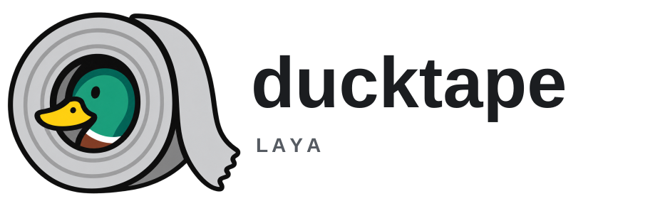

<p align="center">
  <picture>
    <source media="(prefers-color-scheme: dark)" srcset="assets/ducktape-lockup-dark.svg">
    
  </picture>
</p>

ducktape-laya runs [Laya](https://github.com/NandhaKishorM/laya) decision models inside your application. You pass a text (or a JSON value) and a few named questions; it answers each one with calibrated probabilities, on the CPU, in-process. It needs no server, network access or separate runtime (no Python for the C, Node, Rust, Go, Java or .NET bindings), and it does not generate text.

One native library does the work; thin bindings expose it to C/C++, Rust, Node.js and Electron, Python, Go, Java/Kotlin and .NET, plus an experimental browser build (WebAssembly, optional WebGPU).

**Terms used below.** The *state* is the text or JSON the questions are about. A question has one of three types: `choice` picks one of several labelled options, `noul` gives the probability that a statement is true (a yes/no question; the name comes from Laya), and `score` picks a level on an ordered scale. A *model* is a GGUF file (the llama.cpp format) that you download once; an *engine* is a model opened by the library.

## Status

- **Current release: 0.3.0** (2026-10-26), on [GitHub Releases](https://github.com/adrian729/ducktape-laya/releases/tag/v0.3.0), npm, crates.io, PyPI, NuGet, Maven Central and the Go module proxy. Its package files are attested and listed in `SHA256SUMS` ([verify a download](SECURITY.md#verify-a-download)). Its packages run on **Linux x86-64, Linux arm64 and Windows x64**; the browser package is experimental.
- **Platforms:** Linux x86-64 is tier 1 (passes every release check); Linux arm64 and Windows x64 are tier 2 (tested in CI with the English model); macOS on Apple silicon builds from source. Details: [docs/PLATFORMS.md](docs/PLATFORMS.md).

## Requirements

| Platform | CPU | System |
| --- | --- | --- |
| Linux x86-64 | AVX, AVX2, FMA, F16C, BMI2, SSE4.2 (Intel Haswell, AMD Excavator/Zen or newer) | glibc 2.38+ and libstdc++ with `GLIBCXX_3.4.29` (Ubuntu 24.04+); not musl/Alpine |
| Linux arm64 | Armv8.2-A with dot product and FP16 (Graviton2+, Ampere Altra, Raspberry Pi 5) | as Linux x86-64 |
| Windows x64 | as Linux x86-64 | Microsoft Visual C++ Redistributable |

On a CPU without the required features, opening an engine fails with status 7 and names the missing feature (a router checks when its first request loads a model). Plan for about 0.6 GiB of memory per open engine with the English model (1.2 GiB with the multilingual one) and 449 MB of disk for the English model. Language runtimes, tested versions and macOS: [docs/PLATFORMS.md](docs/PLATFORMS.md).

## Install

| Language | Install | Notes |
| --- | --- | --- |
| Node.js, Electron | `npm install ducktape-laya` | Node 20+; prebuilt addon. [Package README](bindings/node/README.md) |
| Python | `pip install ducktape-laya` | Python 3.10+; the wheel bundles the library. [Package README](bindings/python/README.md) |
| Rust | `cargo add ducktape-laya` | Links the native library from the release archive. [Crate README](bindings/rust/ducktape-laya/README.md) |
| Go | `go get github.com/adrian729/ducktape-laya/bindings/go@v0.3.0` | cgo; links the native library from the release archive. [Package README](bindings/go/README.md) |
| Java, Kotlin | `io.github.adrian729:ducktape-laya:0.3.0` | Java 22+, run with `--enable-native-access`; the jar bundles the library. [Package README](bindings/java/README.md) |
| .NET | `dotnet add package DucktapeLaya` | .NET 10; the package bundles the library. [Package README](bindings/dotnet/README.md) |
| C, C++ | [`ducktape-laya-0.3.0-linux-x64.tar.gz`](https://github.com/adrian729/ducktape-laya/releases/tag/v0.3.0) (also `-linux-arm64.tar.gz` and `-windows-x64.zip`) | Headers, library, CMake and pkg-config files. [Linking guide](docs/PACKAGING.md) |
| Browser | `npm install ducktape-laya-browser` | Experimental, tested on Chrome (Chromium) only; 0.3.0 passed on Chrome 156. [Browser guide](docs/BROWSER.md) |

## Get the model

The model is not inside any package. Download the pinned English model (449 MB) and check its hash:

```sh
curl -fL -o Laya-Q8_0.gguf https://huggingface.co/ggml-org/Laya-GGUF/resolve/22265007700297ba9e128297e82540cf28c5d7d4/Laya-Q8_0.gguf
echo 'c06528c5746d3bb8baa72a27938be95abbfd0b226f8471e8a9e365ed0bb066d2  Laya-Q8_0.gguf' | sha256sum --check
```

The multilingual (100+ languages) and typed-decisions models are built from the official checkpoints with one command; see [docs/MODELS.md](docs/MODELS.md).

## Quick start

The same request in three languages: one `noul` question about a short text.

Node.js (an ES module; `require('ducktape-laya')` works too):

```js
import { Laya } from 'ducktape-laya';

const engine = await Laya.open('/path/to/Laya-Q8_0.gguf');
try {
  const result = await engine.execute({
    state: 'Please refund the duplicate charge.',
    questions: { refund: { type: 'noul', instructions: 'Does the customer request a refund?' } },
  });
  console.log(result.answers.refund.noul); // probability that the answer is "true"
} finally {
  await engine.close(); // required: the worker keeps the process alive
}
```

Python:

```python
import ducktape_laya

with ducktape_laya.Engine.open("/path/to/Laya-Q8_0.gguf") as engine:
    result = engine.execute({
        "state": "Please refund the duplicate charge.",
        "questions": {"refund": {"type": "noul", "instructions": "Does the customer request a refund?"}},
    })
    print(result["answers"]["refund"]["noul"])
```

Rust, inside a function that returns a `Result` (results are JSON text):

```rust
use ducktape_laya::{Config, Engine};

let engine = Engine::open("/path/to/Laya-Q8_0.gguf", &Config::default())?;
let result_json = engine.execute(
    r#"{"state":"Please refund the duplicate charge.",
        "questions":{"refund":{"type":"noul","instructions":"Does the customer request a refund?"}}}"#,
)?;
```

Every answer also carries `answer_confidence` (the probability of the reported answer) and `confidence` (how decided the model is). C, C++, Go, Java, .NET and the browser take the same request JSON; see their package READMEs, the ready-made requests in [examples/](examples/README.md) and the [API guide](docs/API.md) for structured decisions, batches, long input and routing between models.

## Performance and accuracy

On a 4-core laptop CPU (Intel Core i7-1165G7, 4 threads), a request with three short questions took 1.5 to 1.8 s with the English model and 0.4 to 0.6 s with the multilingual one (0.2.0-era builds); each question is one model pass, so time grows with the number of questions and the length of the text ([performance](docs/PERFORMANCE.md)). Every release checks each model against results recorded with the original Laya implementation, with probabilities within 0.05 on Linux x86-64 ([accuracy](docs/PERFORMANCE.md#accuracy-against-the-original-laya)); the other platforms are checked with the English model only, and Windows has one documented, separately capped deviation ([known deviations](docs/COMPATIBILITY.md#known-deviations)).

## Documentation

- [API guide](docs/API.md): requests, results, configuration, long input, routing, cancellation, errors.
- [Models](docs/MODELS.md), [performance](docs/PERFORMANCE.md), [platforms](docs/PLATFORMS.md).
- [Linking and deployment](docs/PACKAGING.md) (CMake, pkg-config, loader paths, Electron) and the [browser guide](docs/BROWSER.md).
- [Changelog](CHANGELOG.md), [compatibility and migration](docs/COMPATIBILITY.md), [roadmap](docs/ROADMAP.md).
- [Building from source](docs/BUILDING.md) and the [examples](examples/README.md).
- For maintainers: [architecture](docs/ARCHITECTURE.md), [qualification](docs/QUALIFICATION.md), [release checks](docs/RELEASE_CHECKS.md), [releasing](docs/RELEASING.md), [upgrades](docs/UPGRADES.md).

## Licence and security

The code is MIT. The packages also carry Apache-2.0 components, and the Laya models are Apache-2.0; see [third-party notices](THIRD_PARTY_NOTICES.md). Treat model files as trusted code and report vulnerabilities privately: [SECURITY.md](SECURITY.md). This project is independent of the upstream Laya authors.
